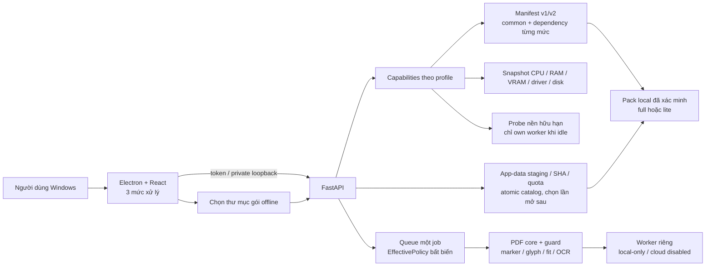
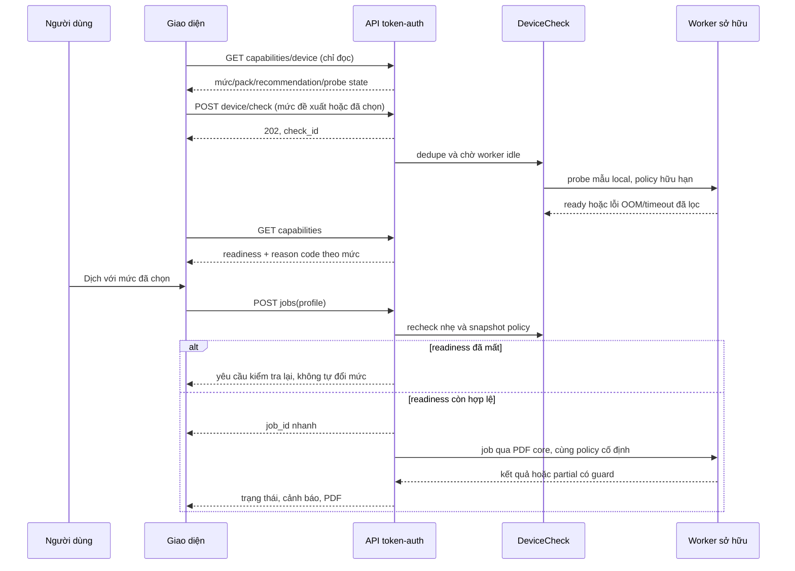

# Kiến trúc bổ sung — BUG-008 và ENH-002

Status: proposed, 28/10/2026. Mô tả quyết định kế hoạch; chưa phải thành phần đã
triển khai. Kiến trúc thực hiện có xem docs/kien-truc/codebase-architecture.md và
agent-knowledge/pdf-engine.md. Root thực thi là checkout feature/offline-engine.

## Các quyết định
| Mã | Quyết định | Lý do |
| --- | --- | --- |
| ADR-01 | BUG-008 technical_verified trước Phase 5 | Có nguồn đầy đủ và baseline dựng lại trước thay đổi tài nguyên. |
| ADR-02 | Giữ Electron/React/FastAPI và core PDF hiện có | Phù hợp Windows hiện tại, bảo vệ viewer/branding/guard. |
| ADR-03 | Manifest v2 common + dependency per-profile, đọc v1 | Pack nhẹ không cần giả cài các mức nặng, pack cũ không bị viết lại. |
| ADR-04 | Snapshot/probe local và EffectivePolicy theo job | VRAM/RAM thay đổi, cần thử thực tế và tránh race giữa polling/job. |
| ADR-05 | Hai edition full/lite, lite đầu tiên chỉ fast | Không hứa các mức chưa đo hoặc đổi ngầm mapping AI. |
| ADR-06 | Import thư mục offline vào app-data và registry atomic | Không tải mạng, không sửa USB/source/portable hay đổi pack giữa job. |
| ADR-07 | Profile/check/error DTO allowlist | Danh tính AI và raw worker details giữ nội bộ. |
| ADR-08 | Cache theo pack/profile/policy ổn định | Tránh tái dùng kết quả sai budget, không invalid cache vì free-memory liên tục đổi. |

## Diagram applicability
| Type | Applicability | Source |
| --- | --- | --- |
| Component/data flow | required | .viepilot/architecture/laptop-offline.mermaid |
| Check/job sequence | required | .viepilot/architecture/laptop-check-sequence.mermaid |
| ERD server database | N/A | Không thêm server database; catalog/check state local có schema riêng. |
| Cloud deployment | N/A | Bản Windows offline; không thêm cloud service, telemetry hay downloader. |

Diagram source: .viepilot/architecture/laptop-offline.mermaid

Diagram source: .viepilot/architecture/laptop-check-sequence.mermaid

## Resource/pack contract
V1: giữ nguyên parser/hành vi tương thích bộ đầy đủ đã có; không rewrite manifest.
V2: mỗi path có size/SHA, common bắt buộc gồm worker/libs/layout/font/OCR/font
sidecar/notices; profile khai báo dependency closure và alias nội bộ allowlist.
Lite chỉ khai báo fast, full có các mức đã chuẩn bị. Schema/path độc hại hoặc common
hỏng khóa toàn runtime; profile thiếu/hỏng không được chạy. Không nhận URL model
hoặc engine/model từ form API. Hiển thị catalog ba mức cả khi mức chưa được cài.

V2 kiểm tra platform/architecture/compatibility revision. Import chỉ chấp nhận
worker/libs khớp runtime tin cậy đang đóng trong app, không chấp nhận binary mới
chỉ vì hash tự khai báo đúng. Nâng runtime cần app tương ứng, không hot-upgrade
executable/DLL qua gói dữ liệu; đây chưa phải quy trình phát hành/ký số bên ngoài.

Catalog app-data ghi ID theo digest, edition, trạng thái và pack đã chọn; path nội
bộ không đưa ra public. Import dùng staging riêng, disk preflight, hash, hủy hữu hạn
và atomic commit. Chỉ đổi selection để dùng ở lần mở sau, giữ pack tốt trước đó.
Không GC/xóa model cũ để giải quyết disk-full trong đợt này.

## Device và policy contract
HardwareSnapshot: RAM/VRAM total+free, CPU/arch, driver, disk free, trạng thái đọc.
Thiếu dữ liệu là unknown. Không thu serial/UUID/process list; không gửi ra mạng.
Chọn nguồn tin cậy và xử lý WDDM/fallback; mọi subprocess có timeout/không shell.

EffectivePolicy cố định lúc nhận job; trước job có recheck tài nguyên. Ưu tiên
truyền qua kênh envs đã có ở translate_pdf -> high_level -> converter -> translator
bằng dữ liệu có version/validation, không sửa biến env process-global. Policy phải
được đặt trước khi BaseTranslator tạo cache. Probe/poll/import không thay policy
hoặc worker của job đang chạy; worker CPU policy cần được cấu hình trước spawn.

Snapshot lúc submit dựa trên probe đã đạt và phép đo nhẹ, rồi giữ cùng profile,
pack và policy khi chờ queue. Worker recheck ngay trước xử lý; nếu tài nguyên
không còn đáp ứng snapshot thì kết thúc có lỗi trung tính/đề nghị kiểm tra lại.
CPU fallback hay giảm context được thử trước khi profile ready, không âm thầm
thay policy của một job đã nhận hoặc đợi probe dài trong HTTP create-job.

Context phải đủ prompt+source+marker+output. Không dựa vào endpoint tokenize chưa
được chứng minh trong binary đi kèm. Dùng tokenizer local tương thích/bound bảo thủ
đã kiểm tra; nếu chưa có budget đáng tin, giữ nguyên đoạn và cảnh báo, không cắt.
Các số token trả về sau generate chỉ là dữ liệu kiểm chứng, không phải preflight.

## Public API dự kiến
| Route | Hợp đồng |
| --- | --- |
| GET /api/capabilities | Giữ fields cũ, thêm recommended_profile/check state và readiness từng mức; không model/vendor/path. |
| GET /api/device | Summary local hữu ích, không định danh phần cứng cá nhân. |
| POST /api/device/check | Token, profile allowlist; 202 nhanh/check_id; một check nền, busy khi job chạy. |
| POST /api/data-packs/import | Thư mục local được picker chọn, schema chặt; copy vào staging mới, trả operation_id. |
| GET /api/data-packs/operations/{id} | Progress/status/reason code đã lọc, không raw path. |
| GET /api/data-packs | ID/edition/mức có sẵn, không registry/alias private. |
| POST /api/data-packs/select | ID đã xác minh, áp dụng lần mở sau khi idle. |
| POST /api/jobs | Vẫn chỉ profile; không chờ probe dài trong HTTP request; recheck/freeze trước queue. |

Response error/code phải allowlist, auth và validation không reflect canary. Không
thêm Swagger/CDN hoặc mở liên kết ngoài trong bản offline. Bridge Electron chỉ
những thao tác picker cần thiết, kiểm tra sender và không expose filesystem rộng.

## Desktop/laptop compatibility
Không migrate/sửa model store gốc hoặc bộ portable 0.3.0. Full default balanced,
fresh lite default fast khi chưa có tương tác; refresh không đổi lựa chọn đã chỉnh.
Driver/RAM/VRAM không đảm bảo tốc độ; tính tương thích chỉ được chứng nhận sau
Phase 7 trên laptop thật. Windows sạch vẫn là gate riêng chưa có bằng chứng.
Version sản phẩm target 0.4.0, component frontend/PDF core là các trục phiên bản
khác; thay metadata runtime trong P7-T1, không đổi lúc lập kế hoạch.

## Nguồn cho triển khai và giới hạn
- [Win32 RAM availability](https://learn.microsoft.com/en-us/windows/win32/api/sysinfoapi/nf-sysinfoapi-globalmemorystatusex): snapshot có thể thay đổi giữa hai lần đọc.
- [NVML memory query](https://docs.nvidia.com/deploy/nvml-api/latest/api/group__nvmlDeviceQueries.html): xử lý reserved/used/free và sai khác WDDM.
- [Context length](https://docs.ollama.com/context-length): tăng context dùng thêm bộ nhớ, không lấy một cấu hình cho mọi máy.
- [Generate API](https://docs.ollama.com/api/generate): metrics/load/done_reason dùng kiểm chứng phản hồi; phải xác minh khả năng binary cụ thể.

