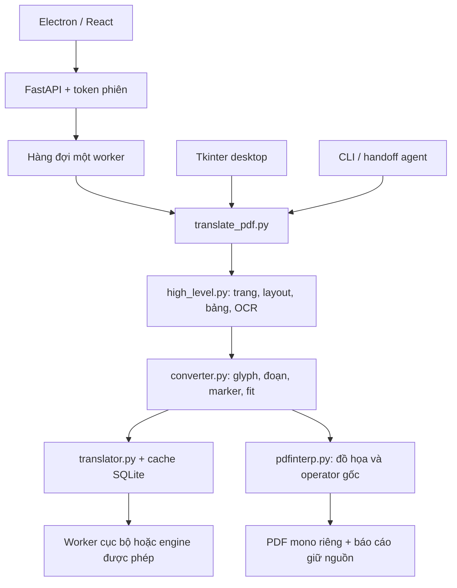

# VP-AUDIT — Bản đồ mã nguồn và trạng thái thực tế, 29/10/2026

## Kết luận chính

VP-PDF/PDF Translate có một lõi bảo toàn PDF đã phát triển sâu, nhưng mã hiện diện ở nhiều checkout với năng lực khác nhau. Đọc riêng thư mục gốc sẽ bỏ sót phần Windows offline, viewer hoàn thiện và nền tảng hỗ trợ laptop. Bản offline đã có nguồn khôi phục và nền tảng tài nguyên; tích hợp policy vào job/token/cache, nhập pack và nghiệm thu laptop vẫn chưa hoàn tất.

Đây là audit mã và kiểm chứng cục bộ. Không sửa mã chạy sản phẩm, không merge, commit, push, tag, phát hành hay ghi đè PDF. Các file mới chỉ là báo cáo, backlog và bằng chứng audit. Mọi thay đổi người dùng có trước được giữ nguyên.

## 1. Phạm vi, checkout và phiên bản

| Vị trí | Git quan sát | Vai trò và tình trạng |
| --- | --- | --- |
| `D:/DataAdmin/vp-pdf` | `feat/domain-glossary`, HEAD `c980d53` | Checkout IDE: Python core, Tkinter, Electron/React/FastAPI đời trước, Android; nhiều thay đổi branding/viewer chưa commit. |
| `.claude/worktrees/frosty-ritchie-f4e306` | `feature/offline-engine`, HEAD `600a04c`; worktree locked | Nguồn Windows offline hiện tại, có nhiều thay đổi tracked/untracked. Phải đọc cây làm việc thực tế, không chỉ HEAD. |
| `.claude/worktrees/vp-audit-codebase-review-74c1fe` | `claude/vp-audit-codebase-review-74c1fe`, HEAD `6e03c96` | Một worktree khác đã đăng ký; không chuyển nhánh, sửa hay gộp trong lượt này. |

`APP_VERSION=0.3.0`, mục tiêu kế hoạch `0.4.0`; frontend component `1.0.0`, bundled PDF core `1.9.11`, Android `0.1.0`. Đây là các miền phiên bản khác nhau, không tự coi là lỗi không đồng bộ. Release desktop được workflow kiểm tra tag `v*` so với `APP_VERSION`; Android dùng `android-v*`.

Runtime `.venv` của checkout IDE là Python **3.11.9**, lệch yêu cầu AGENTS Python 3.12. Worktree offline có `.venv312` **3.12.15**; lượt kiểm tra mới dùng interpreter này và đúng cwd của từng cây nguồn. Không cài lại hay sửa venv cũ.

## 2. Bản đồ kiến trúc



Android là pipeline PDFBox-Android độc lập. Một sửa lỗi Python không tự sửa Android.

### Lớp ứng dụng và orchestration

- `app/gui.py`: CustomTkinter, kéo thả, xếp hàng batch, ngôn ngữ/OCR, tiến độ, lỗi và updater. Luồng legacy này chọn Google; không được suy diễn thành desktop offline hoàn toàn chỉ vì OCR/layout chạy local.
- `app/errors.py`: phân loại lỗi thành mã hỗ trợ và thông tin người dùng có thể sao chép.
- `app/update.py`: kiểm tra release, tải/staging, giải nén, swap bằng PowerShell và rollback. Bản offline có policy ngăn update/network ngoài phạm vi.
- `webui/frontend/electron/main.ts`: cửa sổ, preload, Python child process, token và vòng đời/restart backend. Bản offline ưu tiên `.venv312`, cấp cổng loopback theo phiên, chặn điều hướng/network ngoài allowlist.
- `electron/preload.ts`: cầu API nhỏ cho renderer, token/API base; `nodeIntegration=false`, `contextIsolation=true`, `sandbox=true` được đặt trong BrowserWindow.
- `webui/backend/main.py`: upload PDF, token, validate language/domain/profile, health/capabilities, tạo job, trạng thái, cancel và download. Bản root có 4 endpoint cơ bản; bản offline thêm capabilities/cancel, `/api/engines` trả 410 và từ chối engine/model/field không được phép.
- `services/job_service.py`: serialize document jobs qua một asyncio worker, đưa xử lý CPU/blocking sang thread. Bản offline thêm cancellation, translated_ratio, kept reasons, warnings và trạng thái kết quả một phần.

### Lõi PDF

| Module | Trách nhiệm và nơi sửa phù hợp |
| --- | --- |
| `scripts/translate_pdf.py` | API ổn định: validate input/core bundled/ruleset/ngôn ngữ, pages, engine, OCR, staging, tên đầu ra và kết quả có lý do partial. |
| `pdf2zh/high_level.py` | Đọc/sửa cấu trúc qua bản tạm, layout ONNX, phân vùng trang/bảng, phối hợp OCR và cập nhật content stream, nhúng font, xuất mono. |
| `pdf2zh/converter.py` | Module nhạy cảm nhất: gom glyph thành đoạn, nhận diện công thức/style, gọi translator, wrap/fit và tạo operator PDF. Root hiện khoảng 2.099 dòng. |
| `pdf2zh/pdfinterp.py` | Interpreter mở rộng trên pdfminer: giữ graphics, màu, state, font/glyph và rule gốc trong khi thay nội dung chữ được chọn. |
| `pdf2zh/rules.py` | Heuristic bảo toàn formula/code, cell matching, bullets, TOC/index/nomenclature/references. |
| `pdf2zh/doclayout.py` | ONNX Runtime, backend provider, preprocess/inference và cache optimized graph phù hợp môi trường. Metadata lấy từ session. |
| `pdf2zh/ocr.py` | OCR standard/enhanced cho trang image-only; phân quyền vùng/đoạn, kiểm tra grid/formula/code, cleanup nền, sidecar và fallback giữ scan. |
| `pdf2zh/translator.py` | Registry engine, HTTP/retry/fallback, kiểm tra marker/chất lượng phản hồi, thuật ngữ và tương tác cache. |
| `pdf2zh/cache.py` | Peewee/SQLite WAL; khóa theo engine, tham số và source text. Khởi tạo DB lúc import; cần thư mục cache có quyền ghi. |
| `pdf2zh/glossaries/*.json` | Ba domain: khoa học tự nhiên, công nghệ, y khoa; thay thuật ngữ bằng marker rồi khôi phục. |

Luồng dịch thực tế: validate PDF → tạo staging riêng → OCR nếu được chọn và an toàn → layout theo trang → bảo vệ vùng cấu trúc → gom prose và chèn marker → dịch/cache/kiểm tra → dàn chữ trong giới hạn → ghép graphics/glyph gốc → serialize mono → trả đường dẫn và báo cáo.

### Các bất biến phải giữ khi phát triển

1. PDF nguồn bất biến, số trang/canvas giữ nguyên; chọn một số trang chỉ giới hạn dịch, không cắt trang còn lại khỏi output.
2. Công thức giữ font/glyph/operator gốc; `{vN}` là nội bộ, `<bN></bN>` đi qua translator. Style `<s1..3>` và thuật ngữ cũng phải round-trip hợp lệ.
3. Bảng chỉ dịch trong cell đáng tin khi layout/PyMuPDF match đủ; không có grid tốt thì giữ nguồn. Trang tham khảo/mục lục/chỉ mục cần bảo toàn cấu trúc.
4. Giảm font không dưới 50% nguồn; leading tiếng Việt không dưới 1.10 em; không fit an toàn thì giữ gốc và báo lý do.
5. Không subset font đầu ra: stream đang dùng raw glyph IDs. Renumber glyph có thể làm mất dấu tiếng Việt mà không có exception.
6. Whole-page protected giữ stream nguyên bản, tránh xoay hai lần hoặc làm mất rule. OCR không có nghĩa là được phép xóa mọi chữ trong scan.
7. Không có đoạn nào dịch được phải báo lỗi; tỷ lệ segments không chứng minh dịch đúng thuật ngữ hay không có overlap.
8. Với thay đổi converter/rules/ocr, phải có regression geometry tối thiểu và render PDF thật; unit test chỉ về marker không đủ.

## 3. Windows offline: phần đã có và phần đang chờ

| Thành phần | Hiện trạng mã kiểm tra |
| --- | --- |
| `pdf2zh/offline.py` | Fail-closed network/engine policy, profile công khai, kiểm tra đường dẫn và hash resource, cấu hình asset local. |
| `pdf2zh/resource_pack.py` | Parser manifest v1/v2, common/per-profile dependency closure, compatibility, lite chỉ fast; đã có mã và regression. |
| `services/runtime_service.py` | Worker ứng dụng sở hữu riêng, port local, model store riêng, cloud disabled, startup/require/close, restart CPU/GPU và probe. |
| `services/offline_service.py` | Capabilities theo profile và thông báo lỗi trung tính; không trả danh tính model qua DTO công khai. |
| `pdf2zh/runtime_policy.py` | ResourceSnapshot, EffectivePolicy bất biến, stable_key và tối đa hai candidate CPU/GPU theo tài nguyên. |
| `services/hardware_service.py` | Snapshot CPU/RAM/VRAM/driver/disk local, TTL 5 giây, GPU command timeout 3 giây, unknown khi thiếu dữ liệu. |
| `services/device_check_service.py` | Nền tảng check nền, dedupe, cancel, timeout, primary/rescue probe; chưa nối thành luồng job/UI hoàn chỉnh. |
| `scripts/prepare_offline_pack.py` | Chuẩn bị tài nguyên đang có trên đĩa. |
| `scripts/build_offline_windows.py` | Portable mới từ Python 3.12/Electron/data local, preflight file/disk/hash; từ chối destination đã tồn tại. |

Ba profile công khai là **Nhanh / Cân bằng / Chất lượng cao**. Trong mã nội bộ chúng ánh xạ alias local, retry/rescue khác nhau. CLI trong nhánh này có Ollama/Azure/Google/handoff, nhưng offline policy không cho dùng các engine cloud hoặc model tùy ý.

P4 đã `technical_verified`: 22 file nguồn/build/docs đã được phục hồi; báo cáo cleanup nói "còn thiếu 22 file" là lịch sử trước phục hồi. P5 cũng `technical_verified`: pack v2, hardware snapshot và probe đã có nền tảng.

P6 và P7 vẫn planned. Cụ thể:

- `job_service.py` còn lấy `ProcessingProfile` rồi đặt `PDF_TRANSLATE_PROCESSING_PROFILE` trong environment; chưa truyền `EffectivePolicy` bất biến vào job/translator.
- `translator.py:733` còn cố định `num_ctx=8192`; `num_predict` còn theo độ dài ký tự, chưa dùng token budget đã chứng minh của máy.
- Cache offline đã có revision 3, pack revision và profile; stable_key của policy mới chưa đi vào đường dịch/cache.
- Nền tảng device check chưa có endpoint/UI tích hợp; capabilities hiện chứng minh pack/worker, chưa chứng minh toàn bộ tài liệu chạy được trên laptop.
- Lite/full builder mới, import pack local/USB atomic, lựa chọn cho lần mở sau và UI theo máy còn thuộc Phase 6.
- Laptop RTX 3050 4 GB/RAM 24 GB và Windows sạch/ngắt mạng vật lý chưa được nghiệm thu trong lượt này.

Đây là ranh giới triển khai đã có kế hoạch ENH-002, không tự đánh dấu hoàn thành bằng việc thấy các class nền tảng tồn tại.

## 4. Viewer PDF và khác biệt hai checkout

| Hành vi | Checkout IDE | Worktree offline |
| --- | --- | --- |
| Hai khung gốc/bản dịch | Có | Có, tách `PdfComparison.tsx` |
| Đồng bộ cuộn | Tỷ lệ tổng chiều cao/rộng | Page + offset trong trang + x; giữ offset cả gutter |
| Ctrl + wheel | React `onWheel`, gọi preventDefault | Native listener `{passive:false}`, xử lý deltaMode và giữ điểm dưới con trỏ |
| Kéo chuột | Mouse down/move/up/leave | Pointer capture, xử lý mất capture/cancel, không giành scrollbar |
| Tài liệu dài | Tạo Page/canvas cho mọi trang | Đọc geometry với concurrency giới hạn; canvas chỉ quanh viewport |
| Kiểm thử viewer | Không có script chuyên biệt | Node geometry test + harness Chromium thật, production preload/token/cổng riêng |

Vì vậy các tính năng người dùng từng yêu cầu đã có implementation sâu hơn trong worktree offline. Chúng chưa tự xuất hiện trong checkout IDE; audit không merge hai cây.

## 5. Android và đóng gói

Android dùng Kotlin/Compose, `TranslationController` process-scoped và `TranslationService` foreground; ViewModel quan sát trạng thái thay vì sở hữu tác vụ dài. `PdfLayoutPreserver.kt` gom dòng thành đoạn, giới hạn theo cột, bảo vệ công thức/rotation, xóa và vẽ lại text layer bằng PDFBox-Android. Nó chỉ hỗ trợ PDF có lớp chữ và GoogleTranslateEngine, không thừa hưởng OCR/ONNX hay đầy đủ guard Python.

Desktop legacy dùng PyInstaller `app.spec`/`app-macos.spec` và build scripts; GitHub Actions release hiện hướng vào đường này. Electron có manifest electron-builder, còn offline portable có script riêng. Không coi việc `npm run build` thành công là đã tạo bộ offline chứa model/resources hoặc là đã nghiệm thu release.

## 6. Kết quả VP-AUDIT theo tier

### Tier 1 — Trạng thái: có một mục drift nhỏ

Root không có TRACKER/ROADMAP/HANDOFF/phase-state; `.viepilot` chỉ có tài liệu kiến trúc/UI trước audit này. Không bịa phase hay tag còn thiếu cho root. Worktree offline có state đầy đủ; HANDOFF chỉ sang P6-T1, P4/P5 kỹ thuật đã xác minh; P1-P3 vẫn in_progress do persistence/acceptance là có giải thích.

ROADMAP phần Progress Summary bổ sung vẫn ghi 12 planned, 0 implemented/verified dù bảng/task P4/P5 đã technical_verified. Ghi BUG-013 để cập nhật summary. `execution-plan` chứa trạng thái planned ban đầu cần được hiểu như snapshot kế hoạch, không dùng nó thay trạng thái thực thi mới. Chưa có phase PASS/complete nên không yêu cầu tạo phase-complete tags.

### Tier 2 — Tài liệu: cần đọc đúng phiên bản và đúng checkout

README root mô tả sản phẩm legacy/Google và Android; tài liệu offline cùng shared knowledge nằm ở worktree có nội dung mới hơn. Có tài liệu thiết kế và Mermaid sidecar cho laptop; ERD/cloud được ghi N/A kèm lý do. Version frontend/core khác APP_VERSION là có chủ đích. Các số test/benchmark cũ chỉ là bằng chứng lịch sử, không được dùng làm số pass của 29/10.

### Tier 3 — Phát hiện kỹ thuật đã định vị

| ID | Mức độ | Phạm vi | Bằng chứng và ảnh hưởng |
| --- | --- | --- | --- |
| BUG-009 | High | Root `webui/backend/main.py:53-59` | CORS chỉ allow origin HTTP local; cấu hình thực tế từ chối `null`. Electron production dùng file URL, nên có nguy cơ không gọi được API dù backend ready. Bản offline đã thêm `null` với token phiên. Đây là kết luận từ code/middleware, chưa replay GUI production trong lượt này. |
| BUG-010 | High | Root `job_service.py:36,118` | Repro đưa Translation có 3 đoạn lỗi marker + một trang image-only: DTO chỉ trả `complete`, progress, error; mọi cảnh báo bị bỏ. Bản offline đã có ratio/reasons/banner. |
| BUG-011 | High | Android `GoogleTranslateEngine.kt:49` | `query.take(5000)` cắt đầu vào trước HTTP; caller `PdfLayoutPreserver.kt:127` có thể ghi nhận thành công nếu phần đầu dịch được. Đoạn dài không marker có nguy cơ mất đuôi mà không tăng untranslatedCount. Chưa chạy Android build/runtime trong lượt này. |
| BUG-012 | Medium | Root `translator.py:163-172` | Repro engine trả `<b9>` cho nguồn `<b0>`: gọi translate hai lần nhưng engine chỉ chạy một lần; kết quả sai marker được cache/serve lại. Converter vẫn có thể từ chối trước render, nhưng retry sẽ gặp lại cache hỏng. Bản offline đã có guard và regression. |

Không phát hiện critical được chứng minh trong phạm vi audit. Các hạn chế tài nguyên/laptop tiếp tục ở ENH-002; chậm native startup BUG-007 và thuật ngữ model chính ENH-001 vẫn cần xử lý theo backlog hiện có. Không tự sửa các phát hiện trong lượt đọc hiểu codebase.

## 7. Kiểm chứng mới trong lượt này

| Kiểm tra | Kết quả 29/10/2026 |
| --- | --- |
| Root full unittest | **299/299 đạt, 10,406 giây**, Python 3.12.15 của worktree offline, cwd root. |
| Offline targeted: pack/build/policy/Ollama/cache | **64/64 đạt, 0,686 giây**. HTTP Ollama được chặn/mock bởi module test. |
| Offline full unittest | Đã thử; bị chặn ở lúc asyncio tạo self-pipe/socketpair trên Windows, stack dừng tại `socket.accept`, trước nội dung device-check test. Đã dừng các tiến trình thử của audit. Không tuyên bố full offline suite đạt. |
| pip check | Đạt trên `.venv312`; không chứng nhận venv root Python 3.11. |
| Ruff hard errors | Hai cây `pdf2zh scripts app tests webui/backend`: E9,F63,F7,F82 đạt. |
| Root TypeScript | `tsc -b --noEmit` exit 0. |
| Offline frontend | `npm run test:viewer` đã qua geometry test 1/1 và build TypeScript/Vite; phần Chromium không hoàn tất trong môi trường hiện tại, đã dừng. Không ghi 16/16 pass mới. |
| Native smoke | `test_verify_engine_loads_the_real_native_stack` trong root suite đạt, nạp layout và hai OCR profile thật. Chưa xác minh riêng `app/gui.py --smoke-test` toàn cửa sổ/packaged executable trong lượt này. |
| Git whitespace | `git diff --check` hai cây đạt; có cảnh báo normalization CRLF, không có whitespace error. |
| PDF đọc/render lại | Hai mẫu đã lưu: scientific quality và scan đã dịch; source/output cùng số trang/canvas, không thấy marker lộ/NUL/U+FFFD; nguồn giữ hash. Scientific giữ **134/134 glyph có nét** thuộc CMMI/CMSY/CMEX/CMBX, loại khoảng trắng do extraction tự chèn. |
| Visual PDF | Đã render toàn bộ trang của hai cặp mẫu một trang và xem ảnh đối chiếu; bố cục/công thức/scan còn đọc được. Không dịch lại tài liệu và không dùng kiểm tra này để chứng nhận toàn bộ chất lượng ngữ nghĩa. |
| Android / clean Windows / laptop | Chỉ rà mã Android; chưa build/chạy Android, chưa nghiệm thu máy sạch hoặc laptop thật. |

Điều chỉnh harness cho môi trường: lần đầu temp/cache mặc định không có quyền ghi, nên dùng cache/temp riêng dưới tmp. Chỉ đổi chỗ init cache lúc import và đường dẫn resolver layout sang file ONNX thật đi kèm; native model/OCR và nội dung test không bị giả lập. Không đặt PDF_TRANSLATE_MODEL toàn suite vì một test hợp đồng mock `load_available` kỳ vọng môi trường sạch; lượt controlled giải quyết đúng điều kiện đó. Không sửa nguồn test để ép pass.

Bằng chứng ổn định đi kèm: `audit-evidence-2026-10-29/repro.json`, `pdf-gate.json`, các log root/targeted/checkpoint full offline/frontend và harness. Ảnh QA mới nằm trong `tmp/audit-20261029-pdf-qa/`.

## 8. Guardrails cho lần triển khai tiếp theo

```yaml
stacks: [python, fastapi, electron, react, android-kotlin]
summary_used: repository_contract_and_official_documentation
must_follow:
  - Resolve the implementation checkout before edits; preserve both dirty trees.
  - Keep original PDFs immutable and report partial translations with reasons.
  - Validate formula, style and glossary markers before caching and rendering.
  - Keep output glyph IDs stable; never subset output fonts.
  - Keep offline profiles anonymous and use only the app-owned local worker.
  - Carry one immutable proved policy through job, translator, retry and cache.
  - Check Android separately for every shared preservation assumption.
avoid:
  - Treating technical verification as clean-machine or laptop acceptance.
  - Shipping legacy packaging while assuming it contains worktree-only fixes.
  - Silent input truncation or silent cloud/model/profile fallback.
  - Reusing historical test counts as a new run.
preflight_checklist:
  - Python 3.12 and correct cwd/venv; writable isolated test cache/temp.
  - Full unittest, pip check, hard Ruff and frontend build.
  - Production Chromium preload, file-origin CORS, token and dynamic port.
  - Real scientific/table/rotation/scan renders after preservation changes.
  - Exact source/version/pack hashes before packaging or integration.
needs_detail_lookup: true
```

Đối chiếu hướng dẫn chính thức cho cách ly renderer/preload và upload multipart: [Electron security](https://www.electronjs.org/docs/latest/tutorial/security), [Electron context isolation](https://www.electronjs.org/docs/latest/tutorial/context-isolation), [FastAPI request files](https://fastapi.tiangolo.com/tutorial/request-files/). Các nhận định về lỗi cụ thể ở trên dựa trên mã và repro cục bộ, không phải suy luận rằng dùng đúng framework tự bảo đảm an toàn.

## 9. Thứ tự công việc phù hợp sau audit

1. Xác định nhánh Windows offline là nơi triển khai tiếp; xử lý kế hoạch P6-T1 → T4 rồi P7, dùng state mới thay báo cáo cleanup cũ.
2. Khi tích hợp vào nhánh chính, mang theo viewer, CORS/token/port, partial reporting và safe cache cùng regression; tránh chỉ chép giao diện.
3. Sửa riêng Android long-segment refusal/chunking an toàn trước khi tuyên bố ngang bảo toàn Python.
4. Đồng bộ summary tiến độ và lựa chọn runtime của checkout IDE sau khi có phạm vi tích hợp; không tự bump version hay release.

Theo skill, các phát hiện đã được auto-log dưới `.viepilot/requests/BUG-009.md` đến `BUG-013.md` của checkout IDE. Đây là backlog để xem xét; chúng không đánh dấu implementation đã sửa hoặc tự kích hoạt `/vp-auto`.
