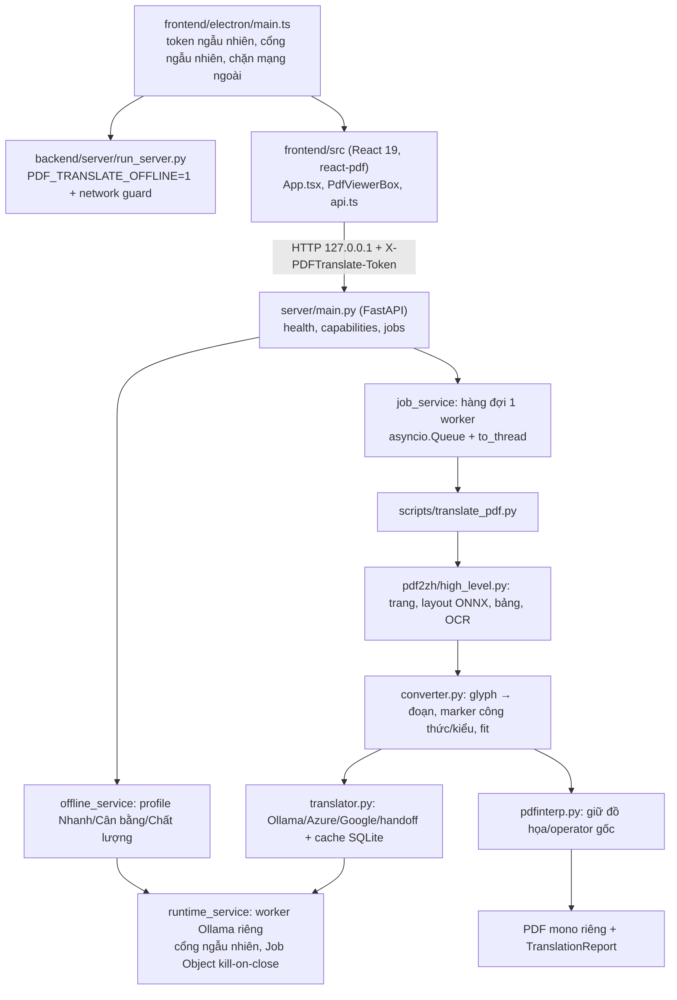

# VP-AUDIT — Phân tích mã nguồn `release/0.4.0`, 09/11/2026

## Kết luận chính

Sản phẩm hiện hành là nhánh `release/0.4.0` (HEAD `30e37d8`, checkout chính
`D:/DataAdmin/vp-pdf`), đã tách thành `backend/` (Python: lõi `pdf2zh` +
FastAPI) và `frontend/` (Electron + React + Android). Lõi bảo toàn PDF vững và
có hồi quy dày; lớp ứng dụng offline chạy được nhưng còn vài lỗ hổng vận hành
(dọn dữ liệu job, token mặc định, liên kết ngoài) và tài liệu/trạng thái
ViePilot chưa theo kịp việc tách thư mục.

Kiểm chứng trong lượt này (chỉ đọc, không sửa mã sản phẩm):

- `backend`: 394/394 unittest đạt (6,2 s, `BAN-CHAY/.venv312`, Python 3.12).
- `frontend`: `tsc -p tsconfig.app.json --noEmit` đạt.
- Cây làm việc checkout chính sạch trước và sau kiểm tra.

Lưu ý phạm vi: báo cáo này nằm trong worktree
`claude/vp-audit-codebase-analysis-bc7e82`, được cắt từ
`fix/pipeline-crash-and-text-corruption` (bố cục cũ có Tkinter, không có
WebUI). Nhánh đó không đại diện cho sản phẩm hiện hành; mọi đường dẫn dưới đây
tính từ checkout chính `release/0.4.0`.

## 1. Bản đồ kiến trúc

Android (`frontend/android`, Kotlin + PDFBox) là pipeline độc lập; sửa lỗi
Python không tự áp dụng cho Android.

### Quy mô

| Khu vực | Dòng (ước lượng) | Ghi chú |
| --- | --- | --- |
| `backend/pdf2zh` | ~7.500 | `converter.py` 2.156, `translator.py` 1.418, `ocr.py` 1.022, `high_level.py` 908 |
| `backend/scripts` | ~1.170 | `translate_pdf.py` 807, build/prepare pack offline |
| `backend/server` | ~1.300 | `main.py` 292 + 7 service |
| `backend/tests` | ~5.400 | 394 test, stdlib `unittest` |
| `frontend/src` + `electron` | ~1.400 | `App.tsx` 494, `main.ts` 304 |
| `frontend/android` | ~5.200 Kotlin | `PdfLayoutPreserver.kt` 1.715 |

### Luồng một job dịch

1. Electron chọn cổng trống, sinh token 32 byte, spawn `python -s run_server.py`
   với `PDFTRANSLATE_DATA_DIR` trong `userData`, truyền token/cổng vào renderer
   qua `additionalArguments` → `preload.ts` → `window.pdftranslate`.
2. `run_server.py` bật chế độ offline và `install_network_guard()`, rồi
   `runtime_service` khởi chạy worker Ollama riêng trên cổng ngẫu nhiên, kiểm
   tra alias model trong gói `offline-data`.
3. Renderer gọi `/api/health` → `/api/capabilities` (định kỳ), rồi
   `POST /api/jobs` (multipart, kiểm tra magic `%PDF-`, giới hạn 100 MiB).
4. `TranslationJobManager` chạy tuần tự từng job: `translate_pdf(engine="ollama",
   model=policy.model, ocr="standard")`, báo tiến độ theo trang, hủy qua
   `threading.Event`.
5. Renderer poll 750 ms, tải blob kết quả, hiển thị hai viewer đồng bộ.

## 2. Tier 1 — Trạng thái ViePilot

| Kiểm tra | Kết quả |
| --- | --- |
| HANDOFF.json ↔ thực tế | ⚠️ Vẫn trỏ `feature/offline-engine`, worktree `frosty-ritchie-f4e306`, next `P6-T1`; không phản ánh việc hợp nhất `release/0.4.0` (02/11) và tách `backend/`/`frontend/` (9b6a756). |
| PHASE-STATE 01-offline, 02-interface, 03-delivery | ⚠️ Còn `in_progress` dù ROADMAP ghi các phần này đã giao/thay thế. |
| ROADMAP ↔ PHASE-STATE (04, 05) | ✅ `technical_verified` khớp. |
| Git tag `vp-p*-complete` | ℹ️ Không có tag; chủ đích (persistence `pending_user_scope`). Không tự tạo. |

## 3. Tier 2 — Tài liệu

| Kiểm tra | Kết quả |
| --- | --- |
| Đường dẫn `webui/` | ⚠️ `agent-knowledge/release.md:3,14`, `agent-knowledge/repository.md:12,40`, `frontend/src/services/api.ts:86` vẫn trỏ `webui/`; `repository.md:87-90` đã mô tả bố cục mới → mâu thuẫn trong cùng tệp. |
| Nguồn phiên bản | ⚠️ `APP_VERSION` đã bị xóa cùng Tkinter nhưng CHANGELOG còn viết "APP_VERSION vẫn 0.3.0"; `frontend/package.json` ghi `1.0.0`. Chưa có nguồn phiên bản duy nhất cho bản Electron 0.4.0. |
| Placeholder URL | ✅ Không thấy `your-org`/`YOUR_USERNAME`. |

## 4. Tier 3 — Stack và chất lượng mã

| # | Mức | Phát hiện | Vị trí |
| --- | --- | --- | --- |
| 1 | medium | Upload và output của mỗi job không bao giờ bị xóa; `_jobs` chỉ tăng. Mỗi lần dịch để lại tối đa 100 MiB nguồn + PDF kết quả trong `userData/data`, tích lũy không giới hạn. | `backend/server/main.py:198-223`, `job_service.py:121-160` |
| 2 | medium | Nếu thiếu `PDFTRANSLATE_API_TOKEN`, backend dùng token cố định `dev-token`; kết hợp CORS cho origin `null` và mọi cổng localhost với credentials, một trang cục bộ bất kỳ có thể gửi job khi chạy dev. Electron luôn đặt token nên bản đóng gói không bị. | `backend/server/main.py:33,68-81`, `frontend/src/services/api.ts` (`'dev-token'`) |
| 3 | low | IPC `open-external` luôn trả `false`, còn `AuthorInfo` gọi `preventDefault()` trước khi gọi IPC → nút Zalo trong hộp tác giả không mở gì trong Electron. Cần xác nhận đây là chủ đích offline hay lỗi. | `frontend/electron/main.ts:249`, `frontend/src/components/AuthorInfo.tsx:14-19` |
| 4 | low | Ngoại lệ phát sinh sau `translate_pdf` (vd. trong `job.record`) bị worker nuốt, không traceback, job kẹt `running` → renderer poll mãi. | `job_service.py:183-184,228` |
| 5 | low | `restart()` đặt `_thread = None` sau `join(timeout=5)` kể cả khi thread cũ còn sống → có thể có hai `_prepare` song song; chờ bằng `time.sleep` vòng lặp. | `runtime_service.py:186-202` |
| 6 | low | Profile truyền vào translator qua biến môi trường toàn tiến trình `PDF_TRANSLATE_PROCESSING_PROFILE` (đúng với 1 worker, dễ vỡ khi song song). Trùng phạm vi P6-T1/ENH-002. | `job_service.py:202`, `pdf2zh/translator.py:522,540` |
| 7 | low | `engine_service.py` (mô tả Ollama/Azure/Google) không còn được server import vì `/api/engines` trả 410; `device_check_service`/`hardware_service` chưa nối vào API (P6 planned). | `backend/server/services/` |

Đã kiểm và **không** phải lỗi: font OCR không nằm trong `extraResources` nhưng
gói offline cấp `PDF_TRANSLATE_OCR_FONT` (`pdf2zh/offline.py:281`).

Điểm tốt đáng giữ: renderer `sandbox` + `contextIsolation`, chặn mọi request
ngoài localhost/cổng API, token `compare_digest`, worker trong Job Object
kill-on-close, upload kiểm tra magic bytes và giới hạn kích thước, lỗi trả mã
trung tính không lộ tên engine.

### Guardrails cho `vp-auto`

- Job mới phải có vòng đời dữ liệu: xóa upload sau khi chạy, giữ output tối đa N job/thời hạn.
- Không có token mặc định cố định ở backend; thiếu token thì sinh ngẫu nhiên hoặc từ chối khởi động.
- Mọi lối ra job (kể cả ngoại lệ ngoài `translate_pdf`) phải về trạng thái kết thúc.
- Không thêm trạng thái theo job vào `os.environ`.
- Tài liệu/đường dẫn dùng `backend/` và `frontend/`, không dùng `webui/`.

## 5. Backlog đề xuất (chưa ghi)

Phiên này chạy trong worktree cô lập nên không ghi được vào
`D:/DataAdmin/vp-pdf/.viepilot/requests/`. ID đề xuất theo thứ tự hiện có:

- BUG-014 — dọn dữ liệu job (#1)
- BUG-015 — token `dev-token` + CORS rộng (#2)
- BUG-016 — liên kết ngoài không mở (#3)
- BUG-017 — job kẹt `running` / race khi restart worker (#4, #5)
- BUG-018 — HANDOFF/PHASE-STATE và tài liệu `webui/` lệch sau tách thư mục (Tier 1–2)
- ENH-003 — gỡ hoặc nối `engine_service`/`device_check_service` (#7)
- #6 ghi bổ sung "Re-detected" vào ENH-002.

Không sửa mã sản phẩm, không commit/merge/push/tag/release.
