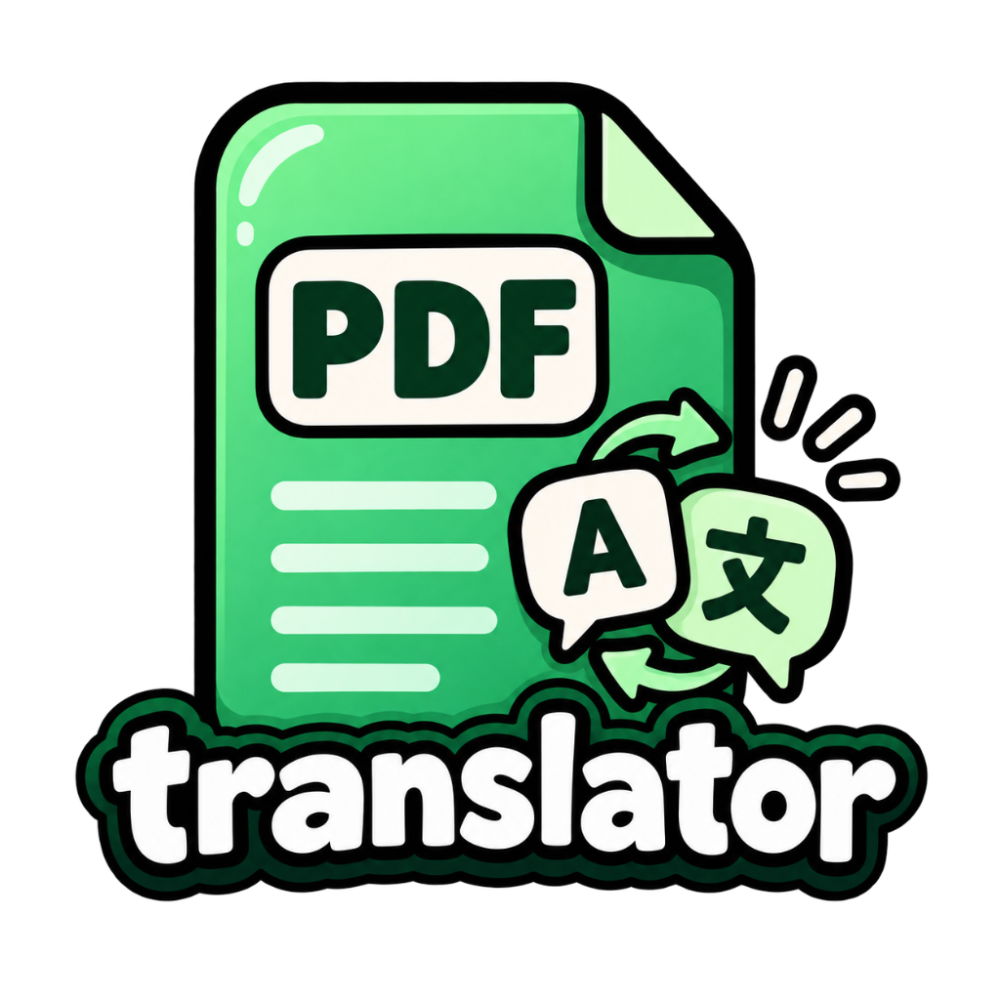

# PDF Translate — Windows ngoại tuyến

Bản Windows đang phát triển xử lý hoàn toàn trên máy, kể cả lần mở đầu. Mở `PDFTranslate.exe` trong toàn bộ thư mục portable được cấp; không dùng bản ZIP legacy bên dưới để thay thế. Giao diện chỉ có **Nhanh / Cân bằng / Chất lượng cao**, không yêu cầu Internet hay cài công cụ AI riêng. Không tự kiểm tra hoặc tải cập nhật. PDF nguồn được giữ nguyên; hãy đối chiếu phần dịch và cảnh báo.

Phát triển: Python **3.12**, `.venv312/Scripts/python.exe`; quy tắc dùng chung tại [agent-knowledge/index.md](agent-knowledge/index.md). Dựng offline bằng `backend/scripts/build_offline_windows.py` từ tài nguyên local đã xác minh; [hướng dẫn và QA hiện hành](docs/bao-cao/offline-windows-2026-10-28.md). Không chạy lệnh tải tài nguyên hoặc cập nhật dependency khi kiểm thử offline.

## Tài liệu legacy được giữ để bảo toàn lịch sử

Phần sau mô tả phiên bản desktop/agent/macOS/Android cũ, bao gồm dịch vụ mạng và cập nhật. Các lựa chọn đó không áp dụng cho bản Windows ngoại tuyến. Thông tin branding người dùng được giữ nguyên; ghi công và giấy phép gốc nằm trong LICENSE và THIRD_PARTY_NOTICES.md.

<p align="center">
  
</p>

<h1 align="center">PDF Translate</h1>

<p align="center">
  <strong>Dịch tài liệu PDF sang tiếng Việt và 35 ngôn ngữ khác<br>mà vẫn giữ nguyên bố cục, công thức, bảng và hình ảnh.</strong>
</p>

<p align="center">
  <sub>Phát triển và duy trì bởi <strong>dhsystem</strong></sub>
</p>

<p align="center">
  <a href="https://github.com/danghoangsqtt-sys/pdf-science-translator/releases?q=android-v">
    
  </a>
</p>

<p align="center">
  <a href="https://github.com/danghoangsqtt-sys/pdf-science-translator/releases/latest"></a>
  <a href="https://github.com/danghoangsqtt-sys/pdf-science-translator/releases"></a>
  <a href="LICENSE"></a>
  
</p>

<p align="center">
  <a href="#điểm-nổi-bật">Điểm nổi bật</a> ·
  <a href="#bắt-đầu">Cài đặt</a> ·
  <a href="#cách-sử-dụng">Cách dùng</a> ·
  <a href="#được-phát-triển-ở-đây">Phát triển</a> ·
  <a href="#dùng-như-agent-skill">Agent Skill</a> ·
  <a href="#giới-hạn-hiện-tại">Giới hạn</a>
</p>

---

PDF Translate là ứng dụng mã nguồn mở dành cho Windows và Android. Công cụ phân tích bố cục từng trang, bảo vệ công thức và code, dịch phần văn xuôi rồi đặt nội dung trở lại đúng vị trí trong tài liệu gốc — không biến PDF của bạn thành một trang chữ trắng đơn giản.

Đây không phải bản dịch giao diện của một công cụ có sẵn. Dự án mượn ý tưởng và phần nhân đọc/ghi PDF từ hai dự án mã nguồn mở, rồi tự xây phần quyết định chất lượng đầu ra: ứng dụng desktop, bộ quy tắc bảo toàn bố cục, lớp xử lý tiếng Việt và hàng loạt bản sửa lỗi ngay trong nhân. Chi tiết ở mục [Được phát triển ở đây](#được-phát-triển-ở-đây).

## Điểm nổi bật

- **Giữ nguyên bố cục:** bảo toàn vị trí của đoạn văn, công thức, bảng, hình, mục lục và tài liệu tham khảo.
- **Xem song song:** bản gốc và bản dịch hiện cạnh nhau ngay trong ứng dụng để kiểm tra công thức, bảng trước khi lưu.
- **Ba bộ dịch:** ngoại tuyến bằng Ollama, Azure Translator, hoặc Google làm dự phòng; có thể ép thuật ngữ theo lĩnh vực.
- **36 ngôn ngữ đích:** mặc định là tiếng Việt, cùng nhiều ngôn ngữ sử dụng chữ Latin.
- **Báo cáo trung thực:** bản dịch thiếu được báo rõ tỷ lệ và lý do; có thể huỷ giữa chừng.
- **OCR cục bộ cho trang scan** (dòng lệnh): đọc và dịch vùng văn bản an toàn; bảng, công thức và hình phức tạp được giữ nguyên.
- **Có chế độ dành cho AI agent:** dùng model trong Codex, Claude Code hoặc Copilot để dịch tài liệu chuyên ngành tốt hơn.

## Bắt đầu

### Ứng dụng desktop (Windows)

Ứng dụng desktop là bản Electron chạy **ngoại tuyến hoàn toàn**: bộ xử lý dịch,
model và font đi kèm trong thư mục ứng dụng, không cần cài Python, Ollama hay
kết nối Internet. Có hai phiên bản: **máy cấu hình mạnh** (ba mức Nhanh / Cân bằng /
Chất lượng cao) và **máy cấu hình yếu** (chỉ mức Nhanh). Chép cả thư mục sang máy
mới rồi mở `PDFTranslate.exe`.

> [!NOTE]
> Giao diện Tkinter cũ đã bị loại bỏ. Các bản `v0.3.x` trên trang
> [Releases](https://github.com/danghoangsqtt-sys/pdf-science-translator/releases) vẫn chạy được nhưng không còn được phát triển
> và sẽ không nhận bản cập nhật mới.

### Android

1. **[Tải APK từ bản phát hành Android mới nhất](https://github.com/danghoangsqtt-sys/pdf-science-translator/releases?q=android-v)** (`PDFTranslate-android-*.apk`). Bản Android được đánh tag riêng theo dạng `android-v*`.
2. Trên điện thoại, cho phép trình duyệt hoặc trình quản lý file **cài ứng dụng từ nguồn không xác định**, rồi mở file APK.
3. Ứng dụng cần Android 8.0 trở lên.

Muốn tự biên dịch:

```bash
cd android
./gradlew assembleDebug
```

> [!IMPORTANT]
> Bản Android là một bản viết lại trên PDFBox-Android, không phải bản desktop biên dịch lại. Nó chỉ đọc PDF dạng văn bản (chưa có OCR) và dùng heuristic thay cho model bố cục BabelDOC/YOLOv8, nên PDF nhiều công thức có thể còn sai chỉ số trên/dưới hoặc phân số. Chi tiết build và phát hành nằm ở [`docs/huong-dan/android-release.md`](docs/huong-dan/android-release.md).

> [!WARNING]
> Bộ cài Windows tự build chưa được ký số, nên Windows SmartScreen có thể cảnh báo (**More info** → **Run anyway**), còn máy bật **Smart App Control** sẽ chặn hẳn. Giải pháp đúng là ký số ứng dụng.

## Cách sử dụng

1. **Chọn tài liệu:** kéo thả một file PDF vào cửa sổ hoặc bấm **Chọn file PDF**.
2. **Chọn cấu hình:** ngôn ngữ đích (mặc định **Tiếng Việt**), lĩnh vực nếu cần ép thuật ngữ, và mức xử lý **Nhanh / Cân bằng / Chất lượng cao**. Mức nào chưa đủ tài nguyên trên máy sẽ hiện lý do.
3. **Bấm Dịch ngay:** thanh tiến độ báo theo trang; bấm **Hủy** để dừng sau trang đang dịch.
4. **Kiểm tra và lưu:** bản dịch hiện bên phải bản gốc; bấm nút tải xuống để lưu `<tên-file>-<ngôn ngữ>.pdf`.

Giao diện hiện dịch từng file một và chưa có OCR. Với PDF scan, dùng dòng lệnh
với `--ocr standard` (xem [Chạy từ mã nguồn](#chạy-từ-mã-nguồn)).

## Được phát triển ở đây

Nhân đọc, phân tích bố cục và render PDF đến từ PDFMathTranslate. Bộ quy tắc
bảo toàn và các bản sửa lỗi trong nhân dưới đây bắt đầu từ VI-Translate của Lê
Ngọc Gia Huy và được tiếp tục phát triển ở đây; ứng dụng desktop là phần
dhsystem viết mới (xem [Giấy phép và ghi công](#giấy-phép-và-ghi-công)):

**Ứng dụng desktop — [`frontend/`](frontend/) + [`backend/server/`](backend/server/)**
Giao diện Electron + React với backend FastAPI cục bộ: xem bản gốc và bản dịch
song song, chọn bộ dịch và lĩnh vực, huỷ giữa chừng, báo rõ phần chưa dịch được.
Không một dòng nào trong thư mục này đến từ dự án gốc.

**Bộ quy tắc bảo toàn — [`backend/pdf2zh/rules.py`](backend/pdf2zh/rules.py) và [contract sản phẩm](references/preservation-rules.md)**
Đây là thứ phân biệt dự án với một công cụ dịch PDF thông thường: nhận diện vùng
công thức và ký hiệu kỹ thuật để không dịch nhầm thành văn xuôi, giữ in đậm và
in nghiêng qua vòng dịch, dựng lại chữ xoay 90 độ đúng chiều thay vì bẻ ngang,
giữ bullet Wingdings/Symbol mà font Unicode không có glyph, tính chiều cao dòng
tối thiểu cho chữ tiếng Việt nhiều dấu chồng.

**Những lỗi tự tìm và tự sửa trong nhân**
Mỗi lỗi dưới đây được phát hiện từ tài liệu thật, truy ra nguyên nhân trong nhân
và sửa tại đây:

- Tiếng Việt mất sạch chữ có dấu chồng — *"Việt"* in ra thành *"Vi t"* — vì
  `subset_fonts` đánh số lại glyph trong khi content stream gọi theo ID gốc.
- Sách dài dừng ngay trước trang cuối vì tài liệu bị nhân đôi rồi nén lại toàn bộ
  ở bước kết thúc.
- Cả trang lộn ngược vì ma trận chữ phản chiếu `1 0 0 -1` bị hiểu nhầm là xoay.
- Đoạn văn in đè lên đoạn bên dưới vì ngân sách chiều cao chỉ tính hộp của chính nó.

Bảng nguyên nhân đầy đủ: [agent-knowledge/regressions.md](agent-knowledge/regressions.md).

**Bộ test hồi quy trong [`backend/tests/`](backend/tests/)**
Mỗi lỗi đã sửa đều bị khoá lại bằng một test dựng đúng hình học nhỏ nhất gây ra nó,
nên bản sửa không âm thầm mất đi ở lần thay đổi sau.

**Chế độ Handoff và Agent Skill**
Một engine dịch thứ hai đưa các đoạn văn sang JSONL cho AI agent dịch theo ngữ
cảnh chuyên ngành rồi dựng lại PDF, cùng chuẩn `SKILL.md` để gọi trực tiếp trong
Codex, Claude Code hay Copilot.

## Ngôn ngữ hỗ trợ

Ứng dụng hỗ trợ 36 ngôn ngữ sử dụng chữ Latin, gồm tiếng Việt, Anh, Pháp, Đức, Tây Ban Nha, Bồ Đào Nha, Ý, Indonesia, Hà Lan, Ba Lan, Thổ Nhĩ Kỳ và nhiều ngôn ngữ châu Âu khác.

Các hệ chữ sau chưa được hỗ trợ: Trung, Nhật, Hàn, Ả Rập, Do Thái, Thái và các chữ Ấn Độ. Ứng dụng sẽ báo lỗi thay vì tạo PDF chứa ký tự ô vuông do thiếu glyph.

## Dùng như Agent Skill

Repo đồng thời tuân theo chuẩn [Agent Skills](https://agentskills.io/) và có thể dùng với Codex, Claude Code, GitHub Copilot cùng các coding agent hỗ trợ `SKILL.md`.

Cài skill cho tất cả agent có trên máy:

```powershell
npx skills add danghoangsqtt-sys/pdf-science-translator -g --all
```

Sau đó gọi skill bằng yêu cầu tự nhiên:

```text
Use $pdf-translate to translate this PDF into Vietnamese.
```

Trong Claude Code hoặc Copilot CLI:

```text
/pdf-translate translate this PDF into Vietnamese.
```

Skill cung cấp hai chế độ dịch:

| Chế độ | Bộ máy dịch | Phù hợp khi |
| --- | --- | --- |
| **Google** | `translate.google.com` | Cần nhanh, miễn phí và không có API key |
| **Handoff** | AI agent trong phiên làm việc | Tài liệu chuyên ngành cần bản dịch theo ngữ cảnh |

Dòng lệnh mặc định dịch bằng Ollama; ứng dụng desktop dịch ngoại tuyến bằng bộ xử lý đi kèm. Handoff trích các đoạn văn sang JSONL để agent dịch, sau đó dựng lại PDF; dữ liệu không được gửi đi đâu nhưng sẽ tốn token và mất nhiều thời gian hơn.

Ví dụ với từ *conduction* trong tài liệu truyền nhiệt:

| Google | Handoff |
| --- | --- |
| “Sự **dẫn điện** xảy ra khi hai vật tiếp xúc trực tiếp” | “**Dẫn nhiệt** xảy ra khi hai vật thể tiếp xúc trực tiếp với nhau” |

Xem quy trình đầy đủ tại [SKILL.md](SKILL.md).

## Chạy từ mã nguồn

### Chuẩn bị môi trường

```powershell
git clone https://github.com/danghoangsqtt-sys/pdf-science-translator.git
cd pdf-science-translator
python -m venv .venv
.venv\Scripts\python.exe -m pip install -r backend/requirements.txt
```

### Dịch bằng Google

```powershell
.venv\Scripts\python.exe scripts\translate_pdf.py INPUT.pdf --output-dir OUT
```

### Dịch bằng Handoff

```powershell
# 1. Trích các đoạn cần dịch
.venv\Scripts\python.exe scripts\translate_pdf.py INPUT.pdf --engine handoff --emit-segments segments.jsonl

# 2. Dùng agent dịch segments.jsonl thành translations.jsonl

# 3. Dựng lại PDF
.venv\Scripts\python.exe scripts\translate_pdf.py INPUT.pdf --engine handoff --segments translations.jsonl --output-dir OUT
```

### Chạy ứng dụng desktop

Cần thêm Node.js 20 trở lên. Từ thư mục gốc của repo:

```powershell
.venv\Scripts\python.exe -m pip install -r backend\requirements-webui.txt
.venv\Scripts\python.exe scripts\fetch_assets.py
cd frontend
npm install
npm run dev
```

Electron tự khởi động backend bằng `.venv\Scripts\python.exe`.

### Build bộ cài Windows

```powershell
cd frontend
npm run build
npx electron-builder --win
```

Bộ cài được tạo trong `frontend\release\`. Bước đóng gói cần sẵn bộ Python
chạy độc lập tại `BAN-CHAY\python_runtime\`; chưa có bản build cho macOS.

## Giới hạn hiện tại

- **OCR ưu tiên an toàn:** văn bản scan thông thường có thể được dịch, nhưng
  trang có bảng/lưới, công thức, hình phức tạp, code hoặc thứ tự đọc không chắc
  chắn sẽ được giữ nguyên và báo là dịch một phần.
- Chữ nằm trong vùng được nhận diện là bảng hoặc hình đôi khi được giữ nguyên theo bản gốc.
- Mục lục, index, danh mục ký hiệu và tài liệu tham khảo được ưu tiên giữ bố cục nên không được dàn lại dòng. Xem [quy tắc bảo toàn](references/preservation-rules.md).
- Mỗi đoạn gửi tới Google được giới hạn ở 5.000 ký tự; phần vượt quá giới hạn không được dịch.
- Với đoạn vốn quá chật, mẫu số của phân số nội dòng có thể vẫn nằm sát dòng bên dưới.

Nên kiểm tra lại tài liệu đầu ra trước khi dùng cho xuất bản hoặc các mục đích yêu cầu độ chính xác cao.

## Giấy phép và ghi công

PDF Translate được phát hành theo giấy phép [AGPL-3.0](LICENSE). Nếu phát hành lại ứng dụng hoặc cung cấp nó như một dịch vụ qua mạng, bạn phải kèm theo mã nguồn tương ứng theo điều khoản của giấy phép.

PDF Translate do **dhsystem** phát triển và duy trì. Dự án tiếp nối [VI-Translate](https://github.com/breslee1707/VI-Translate) của **Lê Ngọc Gia Huy** (huyg.ai), từ đó kế thừa và tiếp tục sửa đổi bộ quy tắc bảo toàn, các bản sửa lỗi trong nhân, CLI, phần lớn bộ test hồi quy, chế độ Handoff, Agent Skill và ứng dụng Android (phần Android do **Lizi** đóng góp cho VI-Translate). Nhân [`backend/pdf2zh/`](backend/pdf2zh/) là bản fork từ [PDFMathTranslate](https://github.com/Byaidu/PDFMathTranslate) 1.9.11, dùng model bố cục và font đã ghim của [BabelDOC](https://github.com/funstory-ai/BabelDOC). Ghi công đầy đủ tại [THIRD_PARTY_NOTICES.md](THIRD_PARTY_NOTICES.md).

Do **dhsystem** xây dựng: ứng dụng desktop Electron + React và backend FastAPI cục bộ ([`frontend/`](frontend/), [`backend/server/`](backend/server/)), bản Windows chạy hoàn toàn ngoại tuyến với worker AI riêng và hồ sơ Nhanh / Cân bằng / Chất lượng, cùng các bản sửa lỗi và tính năng từ tháng 10/2026 trở đi.

---

<p align="center">
  Nếu PDF Translate hữu ích với bạn, hãy tặng repo một ⭐ để nhiều người biết đến dự án hơn.
</p>

<p align="center">
  <sub>Phát triển &amp; duy trì bởi <strong>dhsystem</strong></sub>
</p>
