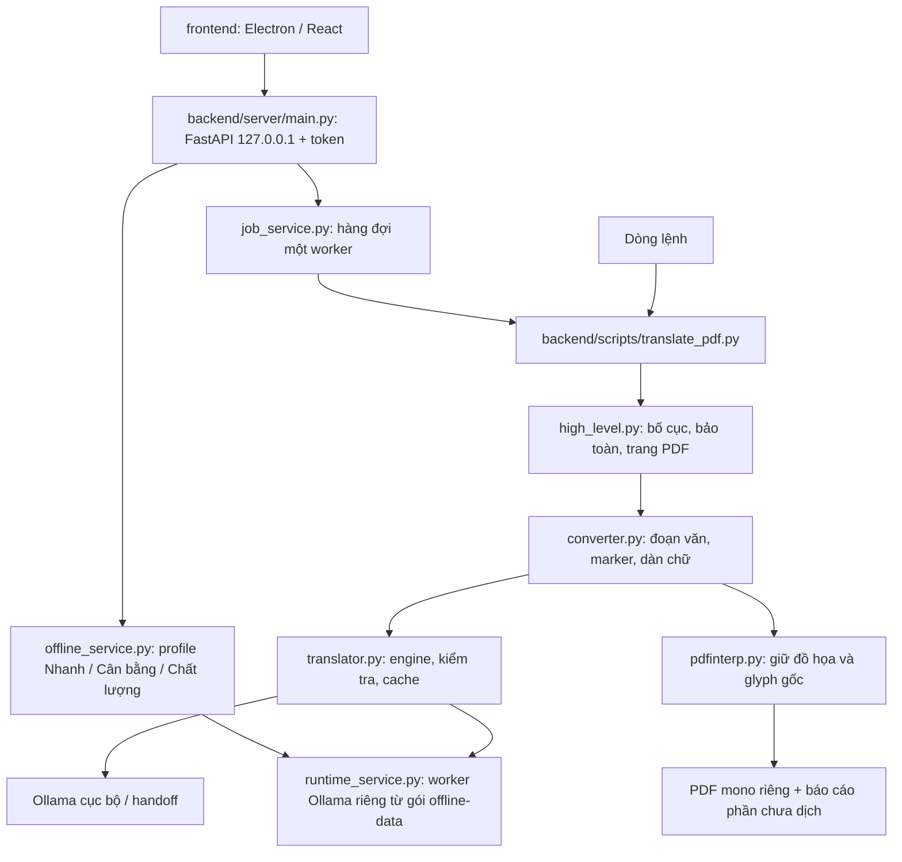

# Bản đồ mã nguồn và các ranh giới bảo toàn

Ngày đối chiếu: 12/11/2026, bố cục `backend/` + `frontend/` (nhánh `release/0.4.0`
và Phase 9). Ứng dụng desktop Tkinter đã bị gỡ ngày 29/10/2026.

## Luồng dịch

| Thành phần | Trách nhiệm và ranh giới |
| --- | --- |
| `backend/scripts/translate_pdf.py` | Xác thực core đi kèm, ngôn ngữ, đầu vào; kiểm tra engine; staging và tên đầu ra ổn định; không ghi đè mặc định. |
| `backend/pdf2zh/high_level.py` | Layout ONNX, ghép ô bảng, trang được bảo toàn, sửa PDF qua bản tạm, tổng hợp báo cáo. |
| `backend/pdf2zh/converter.py` | Ghép glyph, phân đoạn, bảo toàn công thức/kiểu chữ, fit trong vùng an toàn, ghi lý do giữ gốc. |
| `backend/pdf2zh/rules.py` | Quy tắc công thức, bảng, mục lục, chỉ mục, danh mục ký hiệu và tham khảo. |
| `backend/pdf2zh/translator.py` | Registry engine, mạng, thử lại, marker, thuật ngữ, phát hiện kết quả không đáng tin. |
| `backend/pdf2zh/cache.py` | Cache SQLite theo engine, tham số, ngôn ngữ và nội dung; Ollama bổ sung phiên bản xử lý và fallback. |
| `backend/pdf2zh/ocr.py` | OCR cục bộ có điều kiện; không dịch vùng scan không đủ bằng chứng an toàn. |
| `backend/server/main.py` | API `health`, `capabilities`, `jobs`; kiểm tra token, magic `%PDF-`, giới hạn 100 MiB; `/api/engines` trả 410. |
| `backend/server/services/offline_service.py`, `runtime_service.py` | Ánh xạ profile công khai sang model ẩn danh; khởi chạy worker Ollama riêng trên cổng ngẫu nhiên, gắn Job Object. |
| `backend/server/services/job_service.py` | Một worker, hủy giữa các trang, tiến độ, tỷ lệ dịch và cảnh báo theo nguyên nhân. |
| `backend/server/services/engine_service.py`, `device_check_service.py`, `hardware_service.py` | Chưa được API dùng (ENH-003): mô tả engine cũ và kiểm tra máy cho Phase 6. |
| `frontend/electron/main.ts` | Chọn cổng, sinh token, spawn backend, chặn mọi request ngoài localhost. |
| `frontend/src/components/PdfComparison.tsx` | Bật/tắt đồng bộ vị trí và zoom giữa hai bản PDF. |
| `frontend/src/components/PdfViewerBox.tsx` | Đọc liên tục, kéo chuột, zoom tại con trỏ, chỉ tạo canvas gần viewport. |
| `backend/app/assets/`, `backend/app/fonts/` | Chỉ còn tài nguyên: model layout, font PDF Unicode, font OCR (gitignore phần nhị phân lớn). Tên `app/` là di sản; đổi tên theo ENH-010. |
| `frontend/android/` | Engine PDFBox-Android độc lập; không thừa hưởng đầy đủ bảo toàn/OCR từ Python. |

## Những quyết định phải giữ

- Trang/công thức/bảng không an toàn được giữ gốc và báo một phần; không ưu tiên tỷ lệ dịch hơn cấu trúc.
- Công thức dùng `{vN}` nội bộ, chuyển thành `<bN></bN>` khi dịch. Marker kiểu chữ và thuật ngữ cũng được kiểm tra trước khi cache/dựng lại.
- TranslateGemma chỉ gọi mô hình dự phòng sau khi kết quả đầu và các lần cứu marker thất bại. Không có fallback thì giữ gốc; không tự tải mô hình.
- Không dịch được đoạn nào là lỗi, không trả một PDF nguyên gốc dưới nhãn bản dịch hoàn tất.
- Trang được bảo toàn toàn bộ giữ content stream gốc; không subset font đầu ra đang đánh địa chỉ glyph bằng ID.
- Bản đích giữ số trang và canvas. Phần trăm dịch chỉ tính những đoạn có thể gửi dịch, không chứng minh mọi ký tự trong PDF đã được dịch.

## Kiểm chứng và vận hành

Hợp đồng kiểm chứng nằm ở `agent-knowledge/validation.md`. Chạy Python 3.12
trong venv, toàn bộ `unittest`, `pip check`, hard-error Ruff và smoke test.
Với frontend, chạy `npm run test:viewer` trong `frontend/`; trình chạy
loại bỏ `ELECTRON_RUN_AS_NODE` để thực sự kiểm tra Chromium.

Bố cục thư mục, lệnh build và quy ước `BAN-CHAY/`, `BAN-CAI-DAT/` nằm ở
`agent-knowledge/repository.md`.
